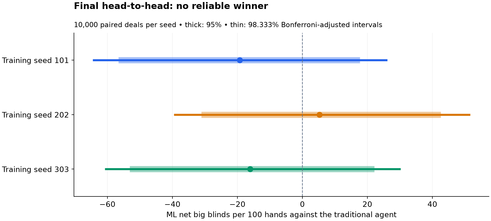

# Poker AI: rules versus reinforcement learning

A reproducible comparison of handwritten and learned action selection in
heads-up Texas Hold’em. Both main agents use the same visible information,
equity estimate and legal betting menu.

The study includes three-seed training, an equity-feature ablation, opponent
robustness checks, and a held-out evaluation of 400,000 hands.

## Start here

- **Understand the project:** [architecture and methodology](docs/project-explanation.md)
- **See the results:** [final report and charts](docs/final-evaluation-20261104/README.md)
- **See it play:** [saved four-hand replay](docs/replay-example/README.md)
- **Run or reproduce it:** [setup below](#run-it) and [reproduction guide](docs/reproduction.md)
- **Browse the implementation:** [source](poker_ai/), [configurations](configs/), [tests](tests/)

## Final result

The final test played **400,000 hands**: 10,000 independent seat-swapped deal
pairs per policy/opponent, using fresh held-out deals. All three original
250,000-decision ML checkpoints were retained.

| ML training seed | Direct return vs traditional (bb/100) | Adjusted 98.333% interval |
|---|---:|---:|
| 101 | −19.3 | [−64.5, +26.2] |
| 202 | +5.3 | [−39.6, +51.6] |
| 303 | −16.1 | [−60.8, +30.2] |

**No reliable direct winner.** All three adjusted intervals include zero;
this does not establish equivalent playing strength. The adjustment targets
95% familywise coverage across the three primary comparisons, with approximate
bootstrap coverage.



In secondary paired comparisons, ML outperforms the traditional baseline
against passive and tight opponents, while the baseline performs better
against random and loose/aggressive opponents. Secondary intervals are
pointwise; beating the baseline against tight play does not establish positive
absolute returns. See the [complete final report](docs/final-evaluation-20261104/README.md).

## What was built

- A PokerKit adapter with sanitized observations, deterministic dealing,
  legal-action masks, seat pairing and chip-conservation checks.
- An equity calculator with a 169-class preflop table, 256 Monte Carlo samples
  on flop/turn, and exact river enumeration.
- An interpretable traditional agent using pot odds, value-betting thresholds,
  position and public aggression history.
- A CPU masked Double DQN: 163 inputs, two 128-unit hidden layers, six outputs,
  38,278 parameters and a bounded 50,000-transition replay buffer.
- Paired evaluation, saved models, source/config hashes, confidence intervals,
  learning curves and readable action traces.

The game uses two players, reset 200-chip stacks and 1/2 blinds, no rake or ante,
and six action slots: fold, check/call, minimum raise, half-pot, pot and all-in.
Illegal and duplicate sizes are removed. Resetting stacks does not erase
accumulated returns.

## Run it

Python **3.11** was tested on an Apple M2 MacBook Air. From the project root:

```sh
python3.11 -m venv .venv
.venv/bin/python -m pip install -r requirements-lock.txt
.venv/bin/python -m unittest discover -s tests -v
```

The local release bundle contains the saved models used by the default demo.
A source-only checkout needs checkpoints restored under
`artifacts/dqn-three-seed-20261104/seed-{101,202,303}/final.pt`, or new training:

```sh
.venv/bin/python -m poker_ai.study --output artifacts/my-training
.venv/bin/python -m poker_ai.demo --checkpoint artifacts/my-training/seed-101/final.pt
```

The default demo uses seed 101 for illustration, not because it was selected as
best. View the [saved four-hand replay](docs/replay-example/README.md), or save
another transcript without changing any policy:

```sh
.venv/bin/python -m poker_ai.demo --output artifacts/my-replay
```

Use fresh output paths; experiment commands refuse to overwrite saved runs.
Checkpoints support inference/inspection, not exact training continuation:
replay-buffer and RNG state are omitted.

## Experiments and evidence

| Experiment | Scope | Result |
|---|---|---|
| Equity audit | Error/compute study against exact river equity | Documents the cost and limits of the probability estimate |
| Traditional development | Zero vs 5% eligible bluffing, plus pot-odds baseline | No convincing bluff improvement; retain no-bluff rules |
| Main training | Three seeds, 250k learner decisions each | Completed in 29.4 minutes; about 295–297 MB peak memory per worker |
| Larger development evaluation | 80k hands, 2k pairs per matchup | Supported the 10k-pair final budget |
| Equity ablation | Three retrained seeds, same budget, 80k evaluation hands | Removing equity lowered all 15 point estimates; some differences inconclusive |
| Configuration robustness | Three opponent variations, 48k hands | Limited robustness; weak exploitation of the looser setting |
| Final held-out deals | Frozen original models, 400k hands | 32.1 minutes; direct winner inconclusive |

Training/evaluation runtimes are measured observations, not portable guarantees.
The final test holds out **deals**, not opponent families. Ablation and robustness
findings remain development evidence. No best seed/checkpoint was selected.

- [Architecture and methodology](docs/project-explanation.md)
- [Final protocol](docs/final-evaluation-protocol.md) and [results](docs/final-evaluation-20261104/README.md)
- [Main learning curves](docs/three-seed-20261104/README.md)
- [Bounded ablation/robustness report](docs/bounded-experiments-20261104/README.md)
- [Equity calculator](docs/equity-calculator.md), [traditional rules](docs/traditional-agent.md), [ML pipeline](docs/ml-pipeline.md)
- [Reproduction and release contents](docs/reproduction.md)

## Reproduce the frozen final test

With the original release checkpoints installed:

```sh
.venv/bin/python -m poker_ai.final_eval --output artifacts/final-reproduction
.venv/bin/python -m poker_ai.final_report --source artifacts/final-reproduction --output docs/final-reproduction
```

This replays the same frozen final seed for reproducibility; it is not a new
independent experiment. Do not use final outcomes to tune or select models.
The release includes the original final hand logs and grouped returns, so the
report can also be rebuilt without replaying all games.

## Code map

| Area | Modules |
|---|---|
| Game and probability | `environment.py`, `match.py`, `equity.py` |
| Policies and learning | `traditional.py`, `features.py`, `learning_env.py`, `replay.py`, `dqn.py` |
| Training/development | `train.py`, `study.py`, `evaluate.py`, `robustness.py` |
| Final evaluation/demo | `final_eval.py`, `final_report.py`, `demo.py` |
| Checks | `tests/` — 75 passing tests in the fresh environment |

All modules live under `poker_ai/`. Configuration snapshots are under `configs/`;
durable reports are under `docs/`; raw experiments and models are under ignored
`artifacts/`.

## Limitations

This is a fixed-opponent learning study, not an equilibrium solver or a human
poker benchmark. Equity assumes a uniform legal opposing hand and is not betting
action EV. The network summarizes history and can produce miscalibrated Q-values.
Three training seeds provide limited replication; hand-level intervals do not
measure training-run uncertainty.
