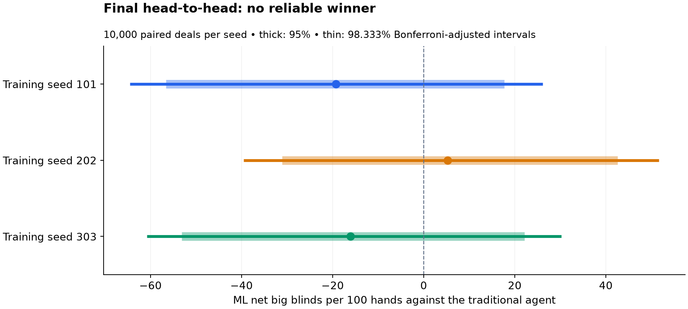
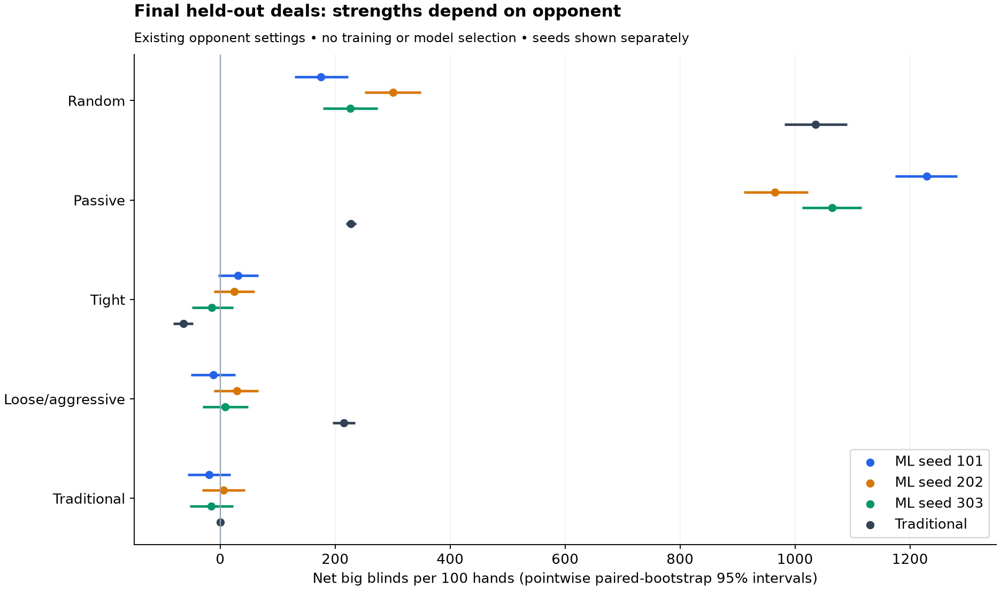

# Final held-out evaluation

Completed 400,000 hands on fresh final-test deals, 10,000 independent seat-swapped deal pairs per matchup. Total evaluation/analysis wall time: 32.1 minutes.

All three original equity-enabled 250k-decision models and the frozen traditional baseline were retained. No retraining, checkpoint selection or additional sampling followed these outcomes. The [protocol](../final-evaluation-protocol.md) was frozen before the run.

## Primary result

There is no reliable head-to-head winner on this test. Every interval includes zero. This is inconclusive, not evidence that the policies are equivalent.

| Training seed | ML bb/100 vs traditional | 95% interval | Adjusted 98.333% interval |
|---|---:|---:|---:|
| 101 | -19.3 | [-56.6, +17.7] | [-64.5, +26.2] |
| 202 | +5.3 | [-31.1, +42.5] | [-39.6, +51.6] |
| 303 | -16.1 | [-53.1, +22.1] | [-60.8, +30.2] |



The three primary comparisons use 10,000 whole-pair bootstrap resamples. Bonferroni-adjusted intervals target 95% familywise coverage across these three fixed-model comparisons; bootstrap coverage is approximate. Deal uncertainty does not measure uncertainty across training runs.

## Secondary matchup results

Return in bb/100 with pointwise 95% intervals. These comparisons are descriptive and not multiplicity-adjusted.

| Opponent | Seed 101 | Seed 202 | Seed 303 | Traditional |
|---|---:|---:|---:|---:|
| Random | +175.0 [+129.2, +222.4] | +300.3 [+251.2, +348.6] | +226.5 [+179.2, +273.6] | +1035.8 [+981.4, +1090.8] |
| Passive | +1228.9 [+1174.1, +1281.8] | +965.0 [+911.1, +1022.6] | +1064.7 [+1012.3, +1115.7] | +227.6 [+218.9, +236.3] |
| Tight | +30.9 [-4.0, +66.5] | +24.4 [-10.6, +59.5] | -14.7 [-49.4, +22.2] | -64.0 [-81.9, -47.4] |
| Loose/aggressive | -12.2 [-50.7, +26.2] | +28.7 [-11.1, +66.1] | +8.3 [-30.9, +48.9] | +215.0 [+195.6, +234.8] |
| Traditional | -19.3 [-56.6, +17.7] | +5.3 [-31.1, +42.5] | -16.1 [-53.1, +22.1] | +0.0 [+0.0, +0.0] |



Paired differences below compare ML and traditional against the same opponent/deals. Positive values favor ML; this differs from direct head-to-head play.

| Opponent | Seed 101 | Seed 202 | Seed 303 |
|---|---:|---:|---:|
| Random | -860.8 [-921.0, -797.6] | -735.5 [-797.4, -671.6] | -809.4 [-870.9, -746.8] |
| Passive | +1001.3 [+948.9, +1054.0] | +737.4 [+683.7, +792.4] | +837.1 [+785.7, +887.7] |
| Tight | +94.9 [+58.4, +133.1] | +88.4 [+50.1, +126.8] | +49.3 [+12.5, +88.4] |
| Loose/aggressive | -227.2 [-269.5, -185.6] | -186.3 [-226.6, -145.3] | -206.7 [-250.3, -162.0] |
| Traditional | -19.3 [-56.6, +17.7] | +5.3 [-31.1, +42.5] | -16.1 [-53.1, +22.1] |

The paired secondary results favor ML against passive and tight opponents for all three seeds. They favor the traditional baseline against random and loose/aggressive opponents. Against tight play, outperforming the baseline does not establish positive absolute returns: all ML absolute-return intervals span zero.

## Additional measurements

- [Position and hand-return spread](position-and-return-spread.csv): returns by BB/SB, individual-hand SD and 5th/50th/95th percentiles. These are descriptive; the inferential unit remains the independent deal pair.
- [Actions and decision latency](actions-and-latency.csv): per-matchup fold/check/call/bet/raise fractions and mean/median/p95 latency. Timing includes feature/equity calculation, excludes opponent actions, and was observed under three concurrent workers with caching.
- [Exact results](summary.json) and [frozen configuration/hashes](run-config.json). Full 400,000 hand records remain in the final-evaluation artifacts and release bundle.

## Limits and reproducibility

The final test holds out deals, not opponent families. The tested game is heads-up, 100 BB stacks reset each hand, no rake, with six discrete action slots and deduplicated legal sizes. Equity assumes uniformly distributed legal opposing cards; the learned history representation is a summary. No human-level, equilibrium or unrestricted-poker claim is supported.

All final logs pass complete-pair, shared-deck and exact-return audits. Frozen model hashes match the development records. The fresh Python 3.11 environment passed 75 tests and reproduced the four-hand demo byte-for-byte. The no-equity and opponent-variation studies remain development evidence in the [bounded report](../bounded-experiments-20261104/README.md).

```sh
.venv/bin/python -m poker_ai.final_eval --output artifacts/final-reproduction
.venv/bin/python -m poker_ai.final_report --source artifacts/final-reproduction --output docs/final-reproduction
```

Replaying the frozen final seed is a reproducibility check, not another independent final test. Do not tune models or choose checkpoints using these results.
