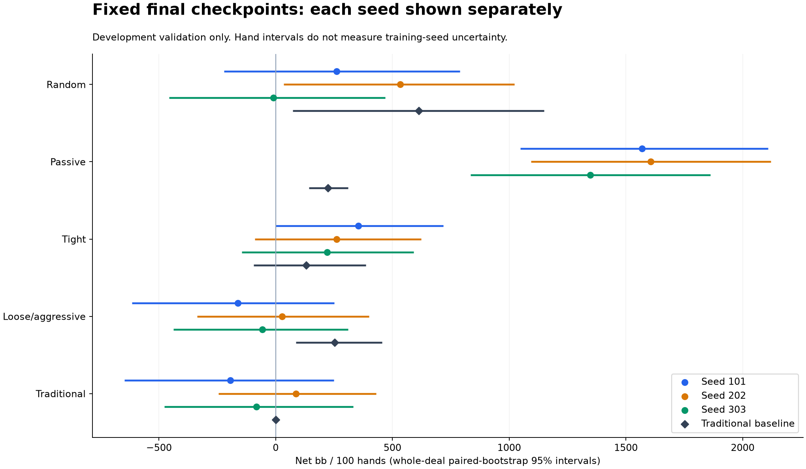
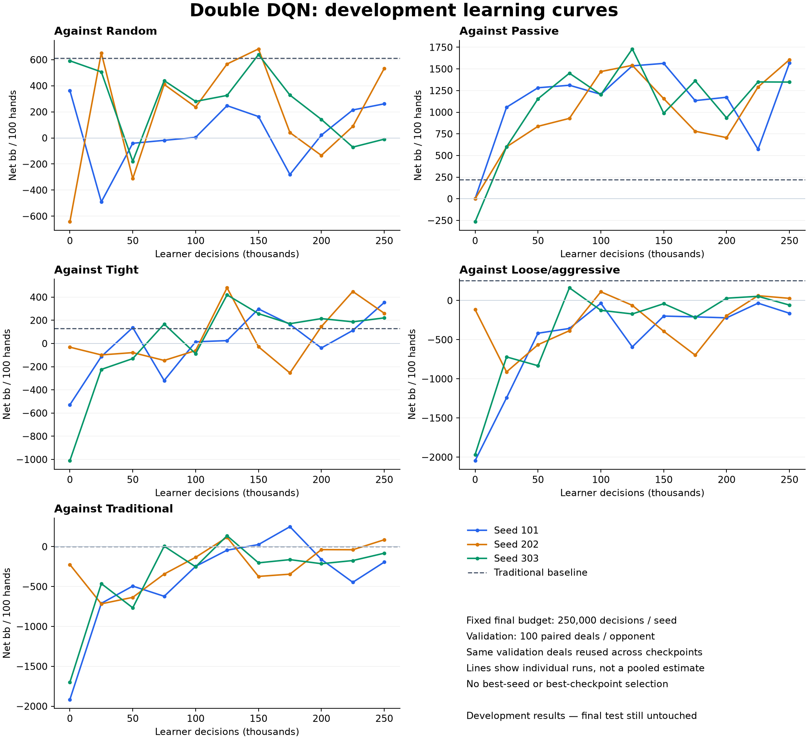

# Three-seed Double DQN development study

Completed 750,008 learner decisions across seeds 101, 202, 303. All runs started from scratch with the frozen configuration.

Each run retained its fixed final checkpoint; intermediate checkpoints were used only for descriptive learning curves. No best seed was selected, no hyperparameters were changed mid-run, and no final-test deals were used.

## Findings

All three learned policies substantially outperform the traditional baseline
against the passive opponent in this validation sample. The paired difference
intervals are positive for every seed. That is evidence of a repeatable learned
exploit within this simple matchup, not broad poker superiority.

Directly against the traditional bot, the final returns are -193.5, +86.5 and
-82.0 bb/100 for seeds 101, 202 and 303. Every corresponding 95% interval spans
zero. This small validation set cannot establish that the learned agents beat,
lose to, or equal the traditional agent reliably. Other matchups also show
substantial deal uncertainty and training-seed variation.

Learning curves include meaningful regressions. More training did not improve
every matchup monotonically, and reporting the best checkpoint would give an
overly favorable account. All three fixed final checkpoints are retained.

## Final validation returns (bb/100)

| Opponent | Seed 101 | Seed 202 | Seed 303 | Traditional baseline |
|---|---:|---:|---:|---:|
| Random | +261.5 | +533.0 | -9.5 | +613.0 |
| Passive | +1568.5 | +1607.0 | +1348.0 | +223.0 |
| Tight | +353.8 | +260.8 | +220.8 | +130.2 |
| Loose/aggressive | -162.5 | +28.0 | -58.0 | +252.5 |
| Traditional | -193.5 | +86.5 | -82.0 | +0.0 |



Each matchup uses 100 paired deals (200 hands). The same decks were used for every seed, checkpoint and traditional baseline. Intervals resample whole deal pairs; they describe deal uncertainty for a fixed policy, not variability across training runs. These are pointwise intervals without multiple-comparison adjustment. With only three seeds, cross-seed mean/SD/range are descriptive. Returns against simple bots are not a human-poker benchmark.

## Learning curves



The horizontal axis is actual learner decisions, including any small overshoot needed to finish a hand. Validation is repeated on a small fixed set; the curves are not an independent final test. Repeated peaks must not be interpreted as best-checkpoint evidence.

## Saved-model replay and behavior

All 15 final-model diagnostic matchups exactly reproduced the recorded
validation returns after reloading the saved checkpoints. All 64 project tests
passed before the study, and all three training workers completed successfully.

Against the traditional opponent on the final validation deals:

| Seed | Decisions | Bets/raises | Folds | Effective all-in raises | All-ins below 50% equity | Selected Q outside [-1,1] |
|---|---:|---:|---:|---:|---:|---:|
| 101 | 730 | 365 | 54 | 45 | 6 | 3 |
| 202 | 689 | 297 | 65 | 43 | 7 | 10 |
| 303 | 721 | 398 | 60 | 40 | 7 | 0 |

The policies still take some aggressive actions with weak showdown equity.
That can be rational bluffing, so counts alone do not establish action-value
errors. Selected Q-values outside the possible terminal-return bounds indicate
some remaining value-calibration error, but do not by themselves explain all
losses. These are on-policy observations, not counterfactual betting rollouts.
No settings were changed after this inspection.

Detailed action counts by street and equity bin are in
[seed 101 behavior](behavior-101.json), [seed 202 behavior](behavior-202.json)
and [seed 303 behavior](behavior-303.json). The earlier pilot diagnostic used a
different validation seed, so its counts are not a controlled before/after
comparison with this table.

## Runtime

| Seed | Decisions | Gradient updates | Training minutes | Peak process MB |
|---|---:|---:|---:|---:|
| 101 | 250,003 | 61,251 | 28.2 | 296.6 |
| 202 | 250,002 | 61,251 | 28.1 | 295.5 |
| 303 | 250,003 | 61,251 | 27.7 | 296.7 |

Whole-study wall time: 29.4 minutes. Training times exclude validation. Three workers used one PyTorch thread each; process memory figures are separate high-water marks, not measured simultaneous total RAM. Checkpoints retain the same inference-only resume limitation as the pilot.

## Reproduction and records

```sh
.venv/bin/python -m poker_ai.study --output artifacts/three-seed-new
.venv/bin/python -m poker_ai.study_report --source artifacts/three-seed-new --output docs/three-seed-new
```

The saved study configuration, source hashes, per-seed summaries and learning curves accompany this report. Full training logs, validation hands and checkpoints remain in the study artifact directory. Plots were generated with Matplotlib 3.11.2.
